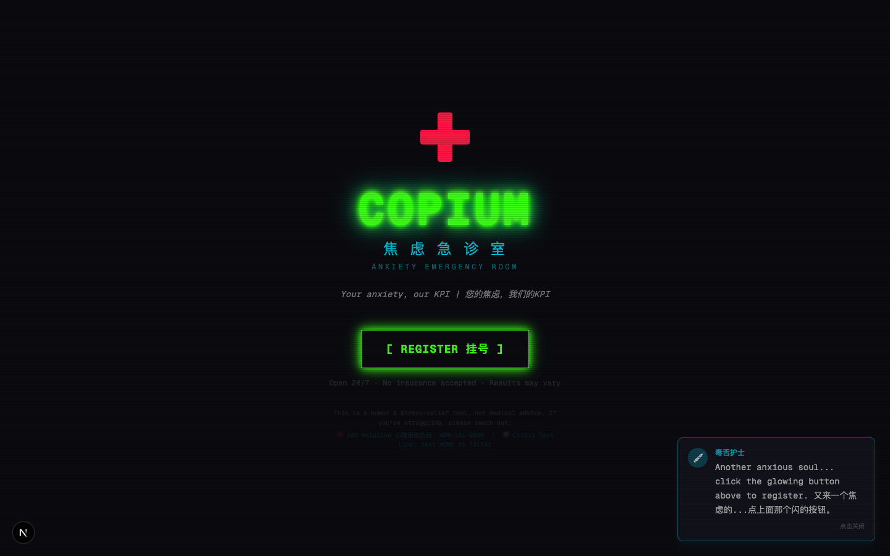

# COPIUM ✚ Anxiety ER

> **Your anxiety is valid. Our treatment is not.**

An AI-assisted humor and stress-relief web app disguised as a cyberpunk emergency room. It offers absurd reframing, animated catharsis, and shareable results; it is not mental-health treatment.

> **Status:** stable · low-frequency maintenance · last verified 2026-10.


[中文版 README](./README_CN.md)



## What Is This?

Life is stressful. Your boss is cryptic. AI might take your job. Monday exists. Traditional coping mechanisms? Boring.

**COPIUM** puts real anxieties through the fictional workflow of a hospital run by chaotic AI doctors — complete with triage, specialized wards, and a discharge report you can screenshot.

## The Wards

| Ward | What It Does |
|------|-------------|
| **Spiral** 🌀 | Dr. Spiral takes your anxiety and escalates it through quantum physics, conspiracy theories, and cosmic timelines until it becomes absurd. Multi-turn therapy that literally spirals. |
| **Boss Decoder** 🔍 | Paste your boss's message. Get 3-layer translation: Surface → Subtext → The Horrifying Truth. Plus a reply you'd never dare send. |
| **Roulette** 🎰 | Enter your profession. Spin the wheel. Find out if AI will replace you — with probability bars, doom/hope/WTF reasons, and a fortune cookie. |
| **Shredder** 💥 | Type what's bothering you. Choose BURN, EXPLODE, or BLACK HOLE. Watch every character get destroyed in satisfying per-letter animation. No AI needed. Pure catharsis. |
| **Reality Check** 🪞 | Describe someone you're envious of. Dr. Mirror reveals the 3 hidden anxieties behind their "perfect life." Plot twist: everyone's a mess. |
| **Sunday Scaries** ⏰ | List your Monday tasks. Get a military-grade survival probability report with threat levels, workplace weather forecast, and motivational quotes that hit different. |

## How It Works

```
[REGISTER 挂号] → AI diagnoses your anxiety type + severity
       ↓
[SMART RECOMMENDATION] → Routes you to the perfect ward
       ↓
[TREATMENT] → Each ward has unique absurd therapy
       ↓
[DISCHARGE REPORT] → Shareable diagnosis card (save as PNG!)
```

## Quick Start

```bash
git clone https://github.com/AliceLJY/copium.git
cd copium
npm install
npm run dev
# Open http://localhost:3000
```

Click the gear in the top-right corner and enter an OpenAI-compatible endpoint that permits direct browser requests, its API key, and a model name. The app has presets for DeepSeek, Kimi, MiniMax, SiliconFlow, and OpenRouter, but provider CORS and model availability can change.

There is no application server proxying prompts. The API key is kept in browser `localStorage`, with a current-tab memory fallback when storage is unavailable. Your key, prompts, and inputs are sent directly from the browser to the provider you select. Do not use a key you cannot safely expose to browser JavaScript.

## Tech Stack

- **Next.js 16** (App Router + Turbopack)
- **Tailwind CSS v4** with cyberpunk neon theme
- **Framer Motion** for animations (page transitions, shake effects, staggered reveals)
- **Browser-side `fetch`** to a user-selected OpenAI-compatible endpoint
- **html-to-image** for shareable result cards
- **Server-Sent Events** for streaming chat responses

## Features

- **Bilingual** — UI labels in English + Chinese, AI responds in whatever language you use
- **Smart Triage** — AI diagnoses your anxiety type and recommends the best ward
- **Saveable Results** — Download your Roulette fortune card or discharge report as PNG
- **Cyberpunk Aesthetic** — Neon glow, CRT scanlines, flicker animations, heartbeat ECG
- **Snarky Nurse** — Random bilingual nurse comments that judge you (lovingly)
- **Crisis interruption** — A deterministic local keyword gate pauses jokes before an AI request and shows human-help resources. It is best-effort, not a diagnosis, and can miss indirect language.

## Disclaimer

COPIUM is a humor/entertainment project. It is **not** a substitute for professional mental health support. If you're going through a tough time, please reach out:

- 🇨🇳 Mainland China mental-health support: **12356**
- 🇺🇸 988 Suicide & Crisis Lifeline: call or text **988**
- 🌏 [findahelpline.com](https://findahelpline.com)

If there may be immediate danger, contact local emergency services or go to the nearest emergency department. If possible, stay with a trusted person and move away from anything that could be used for self-harm.

Your anxiety is real. Our doctors are fictional. Humor may offer a moment of relief, but it is not care.

## License

MIT — fork it, remix it, add your own wards, go wild.

---

*Built with equal parts caffeine, existential dread, and AI collaboration.*
